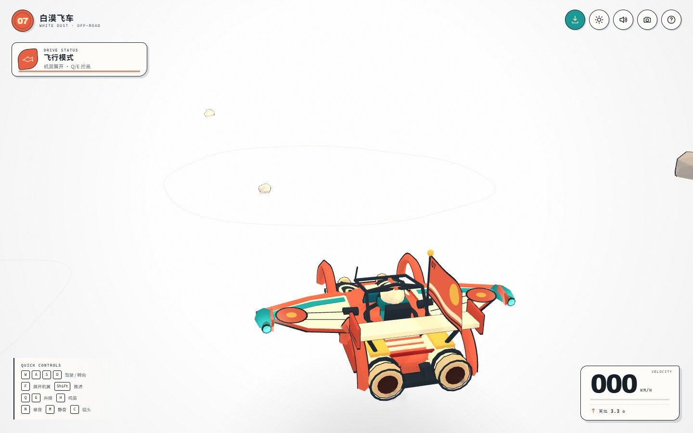

# 白漠飞车 · WHITE DUST 07

一辆会飞的越野赛车，跑在莫比乌斯画风的纯白荒原上。

- 3D 卡通 / 赛璐璐渲染，反向外壳描边，暖纸、珊瑚、湖绿配色
- 纯白昼景与墨蓝夜景；夜晚自动点亮车头灯、尾灯和底盘氛围灯
- 越野赛车：超大有喉管的排气筒、飘动旗帜、防滚架、驾驶员、巨型越野胎
- 飞行模式：四轮向内折叠，两侧机械翼展开，轮组向地面喷射气柱并离地
- 行驶模式：轮组归位，机翼收拢，车辆接地
- 车底实时软影 + 地面接触阴影，飞行高度越高影子越淡
- 随时遇到的低多边形石块、撞击反馈、扬尘与尾气
- 键盘 + 手机触屏双操作；可安装为 PWA，离线可玩
- 纯程序化音效：引擎、风噪、喷气、落地、碰撞、鸣笛。没有背景音乐



## 启动

这是一个完全静态的站点，不需要构建步骤。

```bash
# 使用随附的零依赖静态服务器
npm start
# 或
node tools/serve.mjs
```

然后打开 <http://127.0.0.1:4173/>。

也可以使用任何静态文件服务器，例如：

```bash
python -m http.server 4173 --bind 127.0.0.1
```

> PWA 的 Service Worker 需要 HTTPS 或 localhost。直接双击 `index.html`（file://）无法运行 ES Modules，也无法安装 PWA。

## 操作

| 按键 | 作用 |
| --- | --- |
| `W` / `↑` | 前进 / 飞行推进 |
| `S` / `↓` | 刹车 / 倒车 |
| `A` `D` / `←` `→` | 转向 |
| `Shift` | 推进加速 |
| `F` / `Space` | 起飞 / 降落 |
| `Q` / `E` | 飞行时降低 / 升高 |
| `H` | 鸣笛（可长按） |
| `N` | 白天 / 夜晚 |
| `M` | 静音开关 |
| `C` | 追尾 / 远距镜头 |

触屏：左下方虚拟摇杆控制油门与转向；右侧按钮控制起飞/降落、推进、鸣笛与飞行高度。手机端首屏也会显示触屏提示。

## 手机 PWA

- Android / Edge / Chrome：菜单中「安装应用」或页面右上角的下载图标。
- iPhone / iPad Safari：分享按钮 →「添加到主屏幕」。
- 安装后以 standalone 模式打开，断网后仍可进入已缓存的完整场景。
- `manifest.webmanifest` 包含 192/512/maskable 图标、宽屏和竖屏截图。

## 项目结构

```
index.html                 页面与 HUD
css/app.css                海报式界面、昼夜主题、触屏控件
js/main.js                 启动、输入、镜头、状态与主循环
js/car.js                  赛车建模、机翼/车轮变形、灯光、喷气
js/world.js                白色地面、石块、星空、日月、昼夜灯光
js/effects.js              尾气、扬尘、喷气、火星粒子
js/particles.js            自定义点精灵粒子系统
js/audio.js                Web Audio 程序化引擎与全部音效
js/style.js                调色板、赛璐璐材质、描边、工具函数
vendor/                    Three.js r180（本地化，离线可用）
tools/serve.mjs            零依赖本地静态服务器
tools/make_icons.py        重新生成 PWA 图标
tools/preview.mjs          无头浏览器截图脚本（开发用）
tools/verify.mjs           键盘/触屏/PWA 离线回归测试（开发用）
sw.js                      Service Worker 离线缓存
```

## 技术说明

- Three.js r180，本地 vendored，无 CDN / 无外部资源请求。
- 赛璐璐外观通过 `MeshToonMaterial` 的五段色阶贴图 + 反向外壳描边实现。
- 纯白地面上叠加极浅的风蚀等高线，保留纸张感但不破坏「纯白」。
- 实时阴影使用单方向光跟随赛车，另加接触阴影与飞行时的柔化衰减。
- 所有图形和图标都由代码或 Canvas 生成；旗帜上的太阳标识也是 CanvasTexture。
- 音效全部由 Web Audio 实时合成。首次点击「点火出发」后才启动音频上下文，符合浏览器自动播放限制。
- Service Worker 采用 App Shell 预缓存，导航网络优先、静态资源 stale-while-revalidate。

## 验证

`tools/preview.mjs` 和 `tools/verify.mjs` 需要本机有 Chromium / Edge 和 Node.js；它们通过 DevTools Protocol 驱动真实页面。验证覆盖：

- 页面加载、启动按钮、W 加速
- F 起飞、双翼展开、四轮折叠、Q/E 高度控制
- 夜晚切换与车灯强度
- 触屏摇杆输入
- 降落时轮组恢复、机翼收拢
- Service Worker 激活与断网重载

任何静态托管服务都可以直接部署本目录。请确保 `.webmanifest` 的 MIME 类型为 `application/manifest+json`，并允许 `sw.js` 在站点根作用域注册。

## 版权

Three.js © three.js authors，MIT License，见 `vendor/THREE-LICENSE.txt`。  
场景、赛车、界面与音效为原创实现。视觉语言致敬 Moebius 的线条与色彩，本项目与 Moebius 版权方无关联。
